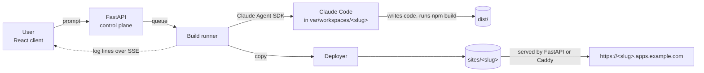

# Prompt to App

Type "Create a web app that will help me track my workouts", and a few minutes later get a link to a working app. Ask "add a weekly chart" and the same link updates.

It works like Lovable or Replit, but runs on **your own cloud VM**. The server hands each request to **Claude Code** (through the [Claude Agent SDK](https://docs.claude.com/en/docs/agent-sdk/overview)). Claude Code writes and builds the app in its own folder, the server deploys the result, and the user gets a URL.

This is a starter project: complete enough to run and learn from, small enough to read in an afternoon, and laid out so you can build on it.



## What it does

- **Prompt in, URL out.** One request becomes a project with its own folder, its own Claude Code session and its own address.
- **Watch it build.** Every step the agent takes ("Write src/App.tsx", "Run npm run build") streams to the browser live, and is saved, so a page reload replays it.
- **Ask for changes.** Each follow-up resumes the same Claude Code session, so the agent remembers what it built and why.
- **A real deploy step.** The finished `dist/` is published with an atomic swap, so visitors never see a half-copied app. A failed change leaves the last good version online.
- **Guardrails.** The agent only gets file and shell tools. A hook checks every tool call against [`agent_policy.json`](server/app/data/agent_policy.json), which keeps it in its folder and away from `curl`, `sudo`, `git` and similar. Each build has a cap on turns, dollars and minutes, and on Linux shell commands also run in Claude Code's OS sandbox.
- **Runs without a key.** `BUILDER=fake` swaps in a builder that writes a small starter app, so you can click through everything and run the tests for free.

## Quickstart (your laptop)

You need **Python 3.11+** with [uv](https://docs.astral.sh/uv/), and **Node 20+**.

### 1. Server

macOS / Linux:

```bash
cd server
cp .env.example .env          # then put your ANTHROPIC_API_KEY in .env
uv sync
uv run uvicorn app.main:app --reload
```

Windows (PowerShell):

```powershell
cd server
Copy-Item .env.example .env   # then put your ANTHROPIC_API_KEY in .env
uv sync
uv run uvicorn app.main:app --reload
```

The API is on http://localhost:8000 (interactive docs at http://localhost:8000/docs). Deployed apps appear at http://localhost:8000/apps/&lt;slug&gt;/.

The Claude Agent SDK ships with its own copy of Claude Code, so there is nothing else to install.

### 2. Client

```bash
cd client
cp .env.example .env          # Windows: Copy-Item .env.example .env
npm install
npm run dev
```

Open http://localhost:5173, pick an example or describe an app, and click **Build it**. A first build usually takes 2–6 minutes.

### No API key yet?

Set `BUILDER=fake` in `server/.env`. The whole flow (queue, live log, deploy, URL, follow-ups) runs for real, but the "agent" just writes a starter app from a template.

## Put it on a cloud VM

This is the setup the project is built for: one VM, Claude Code running on it, and every app served from it.

1. Create an Ubuntu 24.04 VM on any cloud (2 vCPU / 4 GB is enough to start) and open ports 80 and 443.
2. Optional but recommended: point `app.example.com` and `*.apps.example.com` at it.
3. SSH in and run:

   ```bash
   sudo git clone https://github.com/aditya699/prompt-to-app.git /opt/prompt-to-app
   sudo DOMAIN=example.com bash /opt/prompt-to-app/deploy/setup.sh   # or leave out DOMAIN=
   ```

4. Put your key in `/opt/prompt-to-app/server/.env` and run `sudo systemctl restart prompt-to-app`.

The script installs Node, uv, Caddy and the sandbox tools, creates an unprivileged `builder` user, builds the client and starts everything under systemd. With a domain, every app gets its own HTTPS subdomain: `https://track-my-workout-k3x9.apps.example.com`. Step-by-step details and troubleshooting are in [docs/deploy-vm.md](docs/deploy-vm.md).

## Configuration

Everything is set in `server/.env` (each line is documented in [`server/.env.example`](server/.env.example)) and read in one place, [`app/core/config.py`](server/app/core/config.py).

| Variable | Default | What it does |
|---|---|---|
| `BUILDER` | `claude_code` | `claude_code`, or `fake` for the offline starter-app builder |
| `ANTHROPIC_API_KEY` | | Your key from the [Claude Console](https://console.anthropic.com/) |
| `AGENT_MODEL` | `claude-opus-5-5` | The model Claude Code builds with |
| `AGENT_EFFORT` | `high` | `low` to `max`: how hard the model thinks |
| `AGENT_MAX_TURNS` | `60` | A build stops after this many agent turns |
| `AGENT_MAX_BUDGET_USD` | `2.0` | A build stops when it has spent this much |
| `BUILD_TIMEOUT_SECONDS` | `900` | A build stops after this long |
| `MAX_CONCURRENT_BUILDS` | `1` | Builds that run at the same time |
| `AGENT_SANDBOX` | `false` | Run the agent's shell commands in Claude Code's OS sandbox (Linux/macOS) |
| `PUBLIC_BASE_URL` | `http://localhost:8000` | Used to build app links |
| `APP_URL_TEMPLATE` | | e.g. `https://{slug}.apps.example.com` for one subdomain per app |
| `WORKSPACES_DIR` / `SITES_DIR` | `server/var/...` | Where projects are built, and where finished apps are published |

The client has one setting, `VITE_API_URL` in `client/.env`.

**On cost:** you pay for the tokens Claude Code uses, which for a small app is usually well under the default $2 cap. `AGENT_MODEL=claude-sonnet-5-5` makes each build cheaper. Every build's cost is shown in its history entry.

## Project structure

```
prompt-to-app/
├── server/                        FastAPI + SQLAlchemy + Claude Agent SDK
│   ├── app/
│   │   ├── main.py                app factory, lifespan, error handling, /apps static mount
│   │   ├── container.py           wires settings, DB, builder, deployer and services together
│   │   ├── core/                  config, errors, logging, SSE helpers, in-process event bus
│   │   ├── api/routes/            projects, builds (incl. the SSE log), health
│   │   ├── schemas/               Pydantic request/response models
│   │   ├── db/                    SQLAlchemy models (Project, Build, BuildEvent) and session
│   │   ├── repositories/          every SQL query lives here
│   │   ├── services/              build_runner (queue + pipeline), projects, naming
│   │   ├── agents/                Builder interface, Claude Code + fake builders, guardrail policy
│   │   │   └── prompts/           the agent's instructions, as Markdown
│   │   ├── deploy/                Deployer interface + static-folder deployer
│   │   └── data/                  agent_policy.json, examples.json, the starter app
│   ├── tests/                     pytest suite (runs offline with the fake builder)
│   ├── pyproject.toml
│   └── .env.example
├── client/                        React 18 + TypeScript + Vite + Tailwind + TanStack Query
│   └── src/
│       ├── api/                   typed HTTP client, endpoints, SSE reader
│       ├── hooks/                 data hooks (queries) and the build-log hook
│       ├── components/            shared UI: header, buttons, status badges
│       └── features/              home (prompt box, app grid), project (log, preview, changes)
├── deploy/                        setup.sh, systemd unit, Caddyfiles for IP and domain setups
├── docs/                          architecture, API, VM deployment, security, extending
└── .github/workflows/ci.yml       lint, test and build on every push
```

## API

| Method | Path | Description |
|---|---|---|
| `POST` | `/api/projects` | Ask for an app: `{"prompt": "..."}`. Returns the project and its queued build (`202`) |
| `GET` | `/api/projects` | All projects, newest first |
| `GET` | `/api/projects/{id}` | One project with all its builds |
| `POST` | `/api/projects/{id}/builds` | Ask for a change: `{"prompt": "..."}` (`409` while a build runs) |
| `DELETE` | `/api/projects/{id}` | Cancel builds, take the app offline, delete its files |
| `GET` | `/api/builds/{id}/events` | The build log as Server-Sent Events: saved lines, then live ones |
| `POST` | `/api/builds/{id}/cancel` | Stop a queued or running build |
| `GET` | `/api/health` | Builder, model and deployer in use |
| `GET` | `/apps/{slug}/` | A deployed app (local and IP setups; Caddy serves subdomains on a VM) |

Full details, including the log event format, are in [docs/api.md](docs/api.md).

## How the agent part works

[`agents/claude_code.py`](server/app/agents/claude_code.py) calls the Agent SDK's `query()` with:

- `cwd` set to the project's folder, so that is where Claude Code works;
- Claude Code's own system prompt, plus [`prompts/builder.md`](server/app/agents/prompts/builder.md), which says what a deployable app looks like here (static files in `dist/`, data in `localStorage`, relative paths, works on a phone);
- `tools` and `allowed_tools` from the policy file, with `permission_mode="dontAsk"`, so the agent never stops to wait for an approval nobody will give;
- a `PreToolUse` hook that runs [`AgentPolicy.check`](server/app/agents/policy.py) on every tool call and denies anything outside the rules, with a reason the agent can read and adapt to;
- `setting_sources=[]`, so settings files on the machine or in the workspace can't change its behaviour;
- `max_turns`, `max_budget_usd` and, for follow-ups, `resume=<session id of the last good build>`.

The SDK streams back messages. The builder turns text blocks and tool calls into log lines, and keeps the final `ResultMessage` for the session id, cost and turn count. The [build runner](server/app/services/build_runner.py) does the rest: queue, timeout, finding `dist/index.html`, deploying, and recording the result.

## Development

```bash
# server
cd server
uv run pytest            # no network or API key needed
uv run ruff check .      # lint
uv run ruff format .     # format

# client
cd client
npm run lint
npm run build            # type-check + production build
```

CI runs all of these on every push and pull request.

## Build on top of this

Ideas, roughly from easiest to hardest. Each one touches a different part of the stack.

1. **Better first impressions.** Have the agent take a screenshot of the finished app with Playwright and show it on the project card.
2. **Templates.** Start each project from a ready Vite + Tailwind template in the workspace, so builds are faster and more consistent.
3. **Version history.** Keep every build's `dist/` and let the user roll back to any earlier version with one click.
4. **Accounts.** Add sign-in, so each user sees only their apps, and a per-user daily budget.
5. **Full-stack apps.** Let the agent write a small backend too: run each app as a process (or a container) on its own port behind Caddy. Add a `ProcessDeployer` next to `StaticDeployer`.
6. **A container per build.** Run Claude Code inside a fresh Docker container per project instead of a folder, for much stronger isolation between users.
7. **Scale out.** Move the queue to Redis and run builders on several VMs; the API stays the same. The `EventBus` interface is where Redis pub/sub would go.
8. **Bring your own domain.** Let users attach `myapp.com` to a project; Caddy's on-demand TLS already does the certificate part.
9. **Hosted agents instead of your VM.** Swap `ClaudeCodeBuilder` for one that uses Anthropic's [Managed Agents](https://docs.claude.com/), which run the agent in a hosted sandbox.
10. **Evaluate the builder.** Keep 20 prompts, build each one with two prompt or model settings, and compare what works, what it costs and how long it takes.

See [docs/extending.md](docs/extending.md) for step-by-step guides to adding a builder, a deployer and a rule to the policy.

## Troubleshooting

- **"Claude rejected the API key".** `ANTHROPIC_API_KEY` in `server/.env` is missing or wrong. Restart the server after changing it.
- **"The agent finished, but there is no index.html to deploy".** The agent built somewhere other than `dist/`. Read its last messages in the log, then ask for a change: "build it into dist/".
- **A build stops with "used all its turns" or "spending cap".** Raise `AGENT_MAX_TURNS` or `AGENT_MAX_BUDGET_USD`, or ask for a smaller first version.
- **The preview is blank but the build is live.** Open the link in a new tab and check the browser console. Usually an absolute asset path (`/assets/...`); ask the agent to use relative paths.
- **"Can't reach the API".** Is the server running on the port in `client/.env`? Is the client's origin listed in `CORS_ORIGINS`?

## Security

The agent writes and runs code from whatever users type. Only run this somewhere you are happy for that to happen: a VM that holds nothing else. Read [docs/security.md](docs/security.md) before you let anyone else use it.

## License

[MIT](LICENSE)
