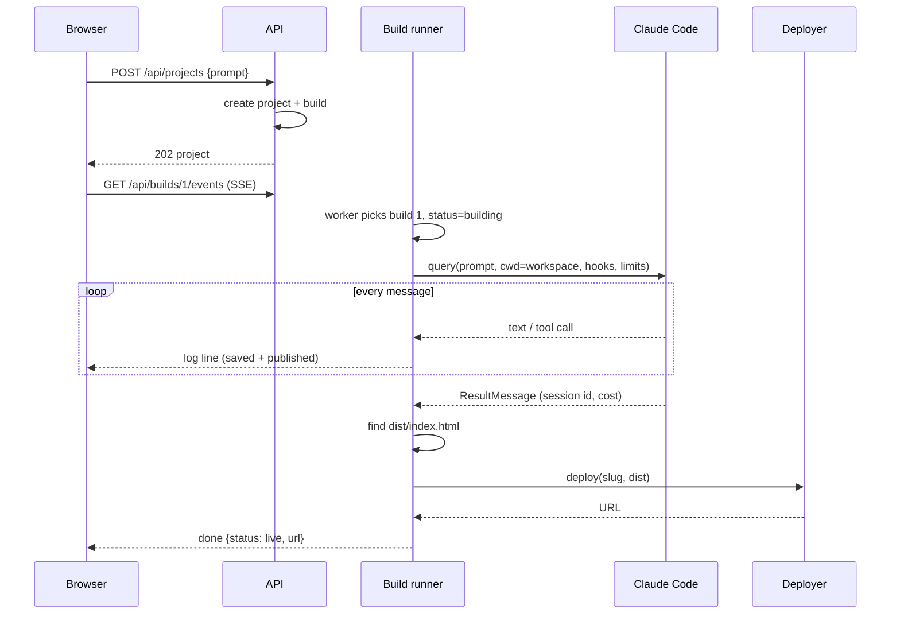

# Architecture

## The pieces

| Piece | Where | Job |
|---|---|---|
| Client | `client/` | Prompt box, list of apps, live build log, preview, change requests |
| API | `server/app/api/` | Thin FastAPI routes. They validate input and call services |
| Project service | `services/projects.py` | Creates projects and builds, deletes projects |
| Build runner | `services/build_runner.py` | The queue and the pipeline: build, find the output, deploy, record |
| Builder | `agents/` | Writes the app. `ClaudeCodeBuilder` (real) or `FakeBuilder` (offline) |
| Policy | `agents/policy.py` + `data/agent_policy.json` | Checks every tool call the agent makes |
| Deployer | `deploy/` | Publishes a built folder and returns its URL |
| Event bus | `core/events.py` | Fans build-log lines out to open browser tabs |
| Database | `db/`, `repositories/` | Projects, builds and every log line (SQLite by default) |

Everything is wired once in `container.py`. Tests build the same container with the fake builder and temp folders.

## One build, start to finish

## States

A **build** goes `queued → building → deploying → live`, or ends `failed` / `cancelled`. Its `error` field says why.

A **project** is `building` while its build runs, `live` once any build has deployed, and `failed` only if it has never been live. A failed follow-up leaves the previous version online, so the project stays `live`.

If the server restarts mid-build, that build is marked failed on startup (Claude Code can't be reattached), and queued builds are picked up again.

## Follow-ups and sessions

Each successful build stores Claude Code's `session_id`. A follow-up runs in the same workspace with `resume=<that id>`, so the agent has the whole earlier conversation (what it built and why) and sees its own files. Sessions are stored by Claude Code in the server user's home folder (`~/.claude/projects/`), which is why the builder must run as the same user every time.

## Why the log goes through the database and a bus

The browser can open the log before, during or after a build, and can lose its connection. So every line is:

1. saved as a `BuildEvent` row with a sequence number, then
2. published on the in-process `EventBus`.

The SSE endpoint subscribes **first**, then reads saved rows, then streams live lines it hasn't sent yet (by `seq`). Nothing falls into the gap, and a client can reconnect with `?after=<last seq>`.

With more than one server process you would replace the `EventBus` with Redis pub/sub; nothing else changes.

## Why static apps

A static site (HTML, CSS, JS and `localStorage`) can be deployed by copying files, served by any web server, and can't affect other apps on the VM. It covers trackers, planners, calculators, games and dashboards, which is most of what people ask for. Full-stack apps are the natural next step: see "Build on top of this" in the README.
